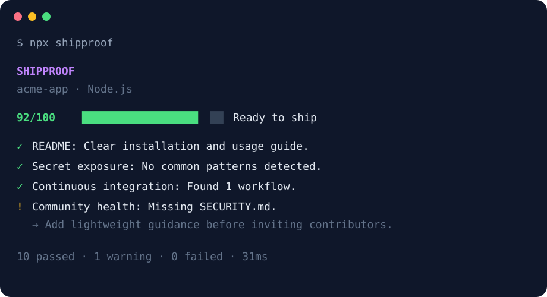

<p align="center">
  
</p>

<p align="center">
  Zero-config release readiness checks for AI-assisted projects.
</p>

<p align="center">
  <a href="https://github.com/CalvaryBloom/shipproof/actions/workflows/ci.yml"></a>
  <a href="https://www.npmjs.com/package/shipproof"></a>
  <a href="https://www.npmjs.com/package/shipproof"></a>
  <a href="LICENSE"></a>
  
</p>

<p align="center">
  English · <a href="README.es.md">Español</a>
</p>

ShipProof gives a project one clear readiness score and explains what to fix before it becomes public. It is fast, local, deterministic, and designed to catch the unglamorous gaps that AI-generated code often leaves behind.

<p align="center">
  
</p>

## Why ShipProof?

AI can create a convincing application in minutes. That does not mean the result is ready for users or contributors. Tests may be placeholders, credentials may be sitting in an environment file, builds may not be reproducible, and the repository may have no license or security policy.

ShipProof turns that vague final review into a repeatable command:

```bash
npx shipproof
```

It currently recognizes Node.js, Python, Rust, and Go projects. It never executes commands from the project being inspected and never uploads source code.

## What it checks

| Area | Examples |
| --- | --- |
| Project | Recognized manifests and valid package metadata |
| Quality | Test, lint, type-check, and build commands |
| Reproducibility | Lockfiles and pinned dependency manifests |
| Security | Sensitive filenames and conservative credential patterns |
| Documentation | README depth, license, and contribution guidance |
| Automation | GitHub Actions workflows |
| Community | Conduct, contribution, and security policies |

The output includes suggestions rather than exposing any matched secret value. ShipProof is a preflight assistant, not a replacement for dedicated security scanners or human review.

## Usage

Requires Node.js 22.13 or newer.

```bash
# Inspect the current directory
npx shipproof

# Inspect another directory
npx shipproof ./my-project

# Produce machine-readable output
npx shipproof --json

# Produce SARIF 2.1.0 for code scanning
npx shipproof --sarif --no-fail > shipproof.sarif

# Report findings without a failing exit code
npx shipproof --no-fail
```

### Options

```text
shipproof [path] [options]

--json        Print machine-readable JSON
--sarif       Print SARIF 2.1.0 for code scanning
--no-color    Disable ANSI colors
--no-fail     Exit with code 0 even when blocking issues are found
-h, --help    Show help
-v, --version
              Show the version
```

By default, ShipProof exits with code `1` when at least one blocking issue is found and `2` for invalid input. This makes it useful in continuous integration. Warnings lower the score but do not change the exit code.

## GitHub Action

Add ShipProof to pull requests without installing or configuring anything in the repository:

```yaml
name: ShipProof

on: pull_request

permissions:
  contents: read

jobs:
  readiness:
    runs-on: ubuntu-latest
    steps:
      - uses: actions/checkout@v7
      - uses: CalvaryBloom/shipproof@v0.2.0
        id: shipproof
```

The action writes a compact score and its actionable findings to the workflow summary. It fails the job when a blocking issue is found; set `fail-on-issues: false` to use it as an advisory check. The outputs `score`, `readiness`, `warnings`, and `failed` are available to later steps.

## GitHub Code Scanning

ShipProof can emit SARIF 2.1.0 so warnings and failures appear in GitHub's code scanning interface. Passing and informational checks stay in the SARIF rule catalog without creating alerts.

```yaml
name: ShipProof code scanning

on:
  push:
    branches: [main]

permissions:
  contents: read
  security-events: write

jobs:
  shipproof:
    runs-on: ubuntu-latest
    steps:
      - uses: actions/checkout@v7
      - name: Generate ShipProof SARIF
        run: npx shipproof --sarif --no-fail > shipproof.sarif
      - name: Upload ShipProof results
        uses: github/codeql-action/upload-sarif@v4
        with:
          sarif_file: shipproof.sarif
          category: shipproof
```

`--no-fail` lets the upload step run even when ShipProof finds a blocking issue; the findings are still recorded as code scanning alerts. Every alert uses a repository-relative location, and potential secret values are never included.

## Scoring

Each applicable check has an explicit weight. Passing earns the full weight, a warning earns half, and a failure earns none.

| Score | Meaning |
| ---: | --- |
| 90–100 | Ready to ship |
| 75–89 | Almost ready |
| 50–74 | Needs work |
| 0–49 | Not ready |

The score is intentionally explainable. It is not a promise that software is correct or secure.

## Local development

```bash
git clone https://github.com/CalvaryBloom/shipproof.git
cd shipproof
pnpm install
pnpm test
node dist/src/cli.js . --no-fail
```

ShipProof has no runtime dependencies. TypeScript and its Node.js declarations are development-only dependencies.

## Roadmap

- Configurable thresholds through `shipproof.config.json`.
- Deeper Python, Rust, and Go checks.
- Optional pull-request comments with score changes.
- A public check catalog with evidence and false-positive guidance.
- Automated trusted publishing with provenance for future releases.

The best roadmap item is the one backed by a real repository and a reproducible failure. Please use the feature request template to share one.

## Contributing

Contributions are welcome. Read [CONTRIBUTING.md](CONTRIBUTING.md) before proposing a check. New checks should remain deterministic, local, safe, and clear about false positives.

Please report vulnerabilities through [private vulnerability reporting](https://github.com/CalvaryBloom/shipproof/security/advisories/new), not a public issue.

## License

[MIT](LICENSE) © 2026 CalvaryBloom
